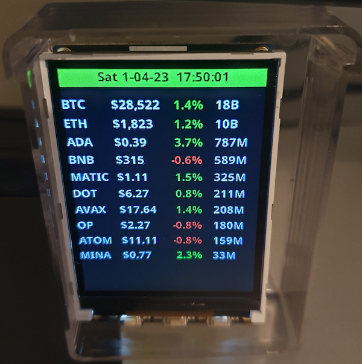

# MQTT Crypto price tracker client using an ESP32-TTGO-T4

The ESP32-TTGO-T4 V1.3 is a 65k colour 320x240 2.4 inch LCD that uses the ILI9341 screen driver. It has a built in ESP32 development board with support for USB/Li-Po battery.  The board also has 3 buttons for user input.  These are not used in this project.  
Text is drawn by using the TFT_eSPI library using the google Noto Sans anti-aliased font that is loaded into a flash array.

The price tracker client displays the coin name, price, daily % move (+ or -) and daily volume.  This information is received by the client listening in on a MQTT topic as a JSON payload.

### Crypto prices display


> The screenshot above predates the table rework described below.

## Display layout
The screen is portrait, 240 x 320. From the top:

1. A timestamp bar with the `time` field of the payload.
2. A header row (`COIN`, `PRICE`, `24H`, `VOL`).
3. One row per coin, in payload order (rows are never re-sorted). 12 rows fit;
   any further coins are not drawn.

Column widths are measured from the payload itself, using the font loaded at
runtime, so nothing is positioned with hand-tuned pixel offsets and longer
values cannot collide with the next column. Prices, change and volume are
right-aligned so their last digits line up; spare width is shared out between
the columns as spacing. Rows alternate a dark grey shading so one coin can be
followed across the table.

When the measured columns plus the volume column do not fit the panel, the
volume column is dropped and the remaining three columns keep their spacing.
This is decided per message, so it depends on the data: values such as
`$1,234.56` and `-12.34%` are wide enough to drop it, while `$28,451` and
`2.2%` leave room. A coin name too long for its column is shortened with `..`.

## Prerequisites
* This code is using platformio with TFT_eSPI, PsychicMqttClient, WiFiManager and ArduinoJson 7 libraries.  Remember to install these libraries first. Refer platformio.ini.
* A MQTT server publishing price JSON payloads to the MQTT_PRICE_TOPIC (crypto/prices) periodically. Refer to [Crypto price server](https://github.com/nilathj/crypto-price-server)

No WiFi details are stored in this repository or in the firmware. They are
entered once on the device, see [Wi-Fi provisioning](#wi-fi-provisioning).

## Crypto price display code
1. Get Wi-Fi credentials from NVS, or from the setup portal on first boot
2. Connect to MQTT server
3. Subscribe to MQTT_PRICE_TOPIC with `mqttClient.onTopic()`
4. onMqttMessage (MQTT client task)
   - Deserialise the JSON payload in the MQTT message (bounded snapshot, `include/quote_board.h`)
   - Hand the snapshot to the Arduino loop task
5. loop task
   - Display crypto price data on the TFT using TFT_eSPI library.

## Wi-Fi provisioning
Nothing about your network is compiled into the firmware. On first boot the
board has no saved network, so it raises its own access point and shows the
details on the LCD:

```
        Wi-Fi setup
Join network:  TTGO-Crypto-3F21
Password:      K7M2QX94AB3Z
Then open 192.168.4.1
```

Join that network from a phone or laptop, open `http://192.168.4.1`, pick your
network from the scan and enter its passphrase. The board saves it and connects.
The same details are printed to the serial monitor.

The access point name ends in two bytes of the chip ID so several boards in
range can be told apart. Its password is **generated fresh on every boot** from
the hardware RNG, so no shared default password exists anywhere, and it is never
stored. The portal closes after 5 minutes; if it closes unconfigured the board
restarts and offers it again.

### Changing or forgetting the network
- Type `reset` on the serial monitor: erases the saved network and restarts into
  the setup portal.
- Or use the *erase* button on the portal's info page (reachable only while the
  portal is open), then power-cycle.
- Or `pio run -t erase` to wipe the whole flash.

So the board can be moved to another network without a reflash, and no sketch
edit is needed for a new deployment.

### Where the credentials live, and what that does and does not protect
`WiFiManager` hands the passphrase to the ESP32 Wi-Fi stack, which stores it in
NVS (`nvs.net80211`) in flash. Consequences worth being explicit about:

- The passphrase is **not** in the source tree and **not** in `firmware.bin`, so
  it cannot leak through Git, a shared build artefact or a screenshot of
  `main.cpp`.
- NVS is **not encrypted by default**. Anyone with the board in hand and USB
  access can dump flash with `esptool.py read_flash` and read the passphrase
  back. Treat a stolen board as a leaked Wi-Fi password.
- Real at-rest protection is ESP32 **flash encryption**, which encrypts NVS with
  a key held in eFuse. That is a device-provisioning step (custom partition table
  plus `CONFIG_SECURE_FLASH_ENC_ENABLED`, and it is irreversible once the eFuse
  is burned); it is not something this firmware does, because enabling it behind
  your back would be destructive.
- Deliberately not done: obfuscating the passphrase with a key derived from the
  chip MAC or a hardcoded constant. That is security theatre — the key ships in
  the same flash image the attacker already has.

The MQTT broker address is still a compile-time constant in `main.cpp`; only the
Wi-Fi details are provisioned so far.

## Large payloads
MQTT payloads larger than the client's 1 KB receive buffer arrive in several
parts. PsychicMqttClient (built on the ESP-IDF MQTT client) reassembles the
parts and only then calls the message handler, so the JSON is never parsed from
a fragment. The handler runs on the MQTT client task, which is given an 8 KB
stack in `setup()` because it does the parsing.

The JSON is parsed with an ArduinoJson filter that keeps only `time` and the
four displayed fields of each coin, into a fixed-size snapshot of at most 16
coins (`include/quote_board.h`). Parse allocations come from PSRAM when the
board has it, falling back to internal RAM otherwise. The snapshot is handed to
the Arduino loop task through a one-slot queue, and the display is written only
from `loop()`.

Failure modes are explicit rather than fatal: a payload over 64 KB, a malformed
payload, or one that does not fit in memory is logged to serial and ignored,
leaving the previous screen up. Note that the reassembly buffer itself is
allocated by the MQTT client for the full message, so a broker that publishes
messages larger than the free heap can still exhaust the client; keep the
payload to what the display can use, or cap it on the broker
(e.g. mosquitto `message_size_limit`).

## When prices appear
Prices show up as soon as MQTT is connected, not at the next scheduled publish.
The price server publishes with `retain=True`, so the broker keeps the latest
payload and delivers it immediately to a new subscriber.

Because two things want to paint the screen — the connection status and the
price table — the view decision is centralised in `include/display_state.h` and
repainted from one place in `loop()`:

- before any payload arrives, the screen shows connection status;
- once a payload has arrived it stays on screen, and a link transition only
  changes the header bar (orange, with the link status) so the prices remain
  visible and are marked stale rather than erased;
- a new payload always wins, and the bar returns to the payload timestamp.

Previously the status and the table were drawn independently, so the
`MQTT Connected..` transition could paint over a table drawn moments earlier; the
next table then only appeared at the server's next 5-minute cron run.

## Tests
Host tests run against the same headers the firmware compiles:

- `test_quote_board` — the payload parser, including a 68 KB payload that is
  deliberately not null-terminated.
- `test_quote_layout` — the table geometry: the volume-column drop rule,
  rows-per-screen, header spacing, and name truncation bounds.
- `test_wifi_setup` — the setup-portal password (always WPA2-acceptable, no
  confusable characters, unbiased over the whole alphabet, distinct per draw)
  and the log redaction helper.
- `test_display_state` — the screen view rule: prices already on screen must
  never be replaced by a connection-status message.

```
pio test -e native
```

## Structure of the expected JSON in the MQTT payload
```
{
   "time":"Sat 1-04-23  19:09:15",
   "coins":[
      {
         "name":"BTC",
         "price":"$28,451",
         "price_change_24h":"2.2%",
         "vol":"17B"
      },
      {
         "name":"ETH",
         "price":"$1,825",
         "price_change_24h":"1.5%",
         "vol":"10B"
      },
      {
         "name":"ADA",
         "price":"$0.39",
         "price_change_24h":"1.4%",
         "vol":"759M"
      },
      {
         "name":"DOT",
         "price":"$6.26",
         "price_change_24h":"0.6%",
         "vol":"202M"
      }
   ]
}
```

## Design
Python crypto price server running in docker --> MQTT server --> ESP32-TTGO-T4 client

## Hardware
- [TTGO T4](https://www.aliexpress.com/w/wholesale-TTGO-T4.html)
